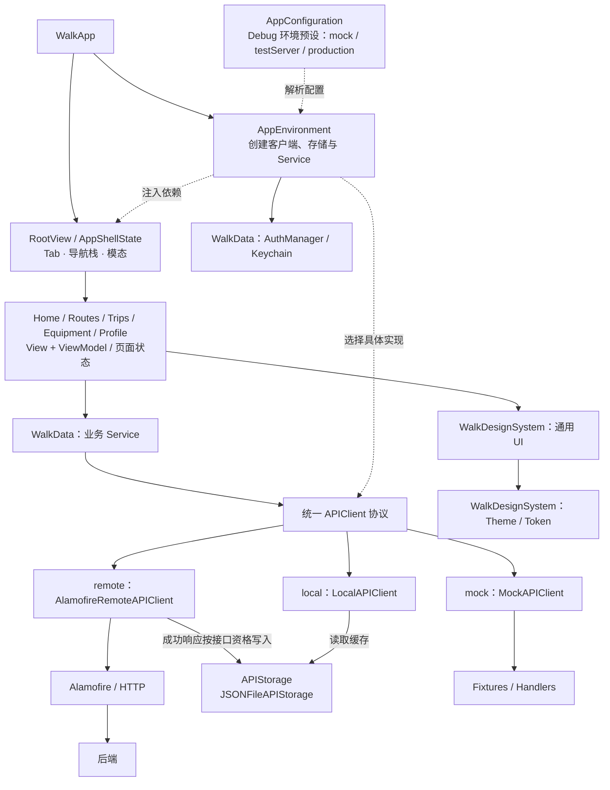

# Walk iOS 整体架构调研

调研日期：2026-09-24。设计基准：[平台规范中的 App 架构](../specs/README.md#app-架构基准)。本文件是当前源码的调研证据，不是另一份架构规范。

## 结论

**约定架构的主体就是当前 App 的真实构成。** App → Feature（View / ViewModel）→ Service → APIClient 是五个业务域实际使用的主路径；Mock、HTTP、响应存储、认证、Theme 与通用 UI 均有具体实现，不是仅有目录或协议声明。

目标图还包含两项尚未完整落地的设计：

1. 数据源当前仍是 `remote / local / mock` 三种客户端装配。远端客户端请求网络并按接口资格写缓存，独立 local 客户端读取缓存；尚未形成目标中的统一真实数据能力及 `real / remoteOnly` 配置。
2. 当前有 App 内的 Debug 环境设置，但没有接入 DebugSwift，也没有独立 DebugTools 模块。设置项仍为 `mock / testServer / production`，后两项都走远端客户端。

因此，这张图可作为现有架构的整理与后续设计基准；主干有真实代码依据，不能把上述两个目标能力写成已经完成。个别文件职责越界、局部 Bug 或测试问题不改变本次对总体构成的判断。

## 调研口径

- 以当前工作树为对象，沿实际入口、依赖组装和五域调用链核对，不以目录名称代替消费证据。
- 对上一轮尚未完成的缓存与认证草稿，结合 `git show HEAD`、工作树差异和 App 装配点区分“存在接口”与“已经接入”。
- 只判断整体组成、主要职责和依赖关系，不开展逐文件合规审计，不将零散问题升级为架构缺失。
- 这是静态源码调研；本轮只更新文档，没有运行构建、测试或 E2E，不提供运行时验收结论。

## 当前真实构成

协议到具体客户端的连线表示可替换实现，实际选择发生在 AppEnvironment。此图省略辅助系统适配与预览/基线入口，只呈现正常业务主路径。

### 主干在五个业务域的落点

正常 App 入口创建 [AppEnvironment](../Walk/App/WalkApp.swift)，进入 RootView；[AppEnvironment](../Walk/App/AppEnvironment.swift) 创建 Route、Equipment、PersonalTrip、TripEquipment、Account 五类 Service，并将所选的同一个 APIClient 注入其中。[RootView](../Walk/App/RootView.swift) 负责页面与依赖的连接，[RootNavigation](../Walk/App/RootNavigation.swift) 承载全局导航状态。

| 业务域 | 当前实际调用链 | 生产证据 |
|---|---|---|
| 首页 | HomeView → HomeViewModel.load → PersonalTripService.focus → APIClient | [HomeViewModel](../Walk/Features/Home/HomeViewModel.swift)、[PersonalTripService](../Packages/WalkData/Sources/WalkData/Repositories/PersonalTripService.swift) |
| 路线 | RouteDiscoveryView → RouteDiscoveryViewModel.loadRoutes → RouteService.getFeaturedRoutes → APIClient | [RouteDiscoveryViewModel](../Walk/Features/Routes/RouteDiscoveryViewModel.swift)、[RouteService](../Packages/WalkData/Sources/WalkData/Repositories/RouteService.swift) |
| 行程 | CreateTripView → CreateTripViewModel.submit → PersonalTripService.create → APIClient | [CreateTripView / ViewModel](../Walk/Features/Trips/CreateTripView.swift)、[PersonalTripService](../Packages/WalkData/Sources/WalkData/Repositories/PersonalTripService.swift) |
| 装备 | EquipmentListView → EquipmentListViewModel.load → EquipmentService → APIClient | [EquipmentListViewModel](../Walk/Features/Equipment/EquipmentListViewModel.swift)、[EquipmentService](../Packages/WalkData/Sources/WalkData/Repositories/EquipmentService.swift) |
| 我的 | RootView 注入 ProfileViewModel → ProfileView 加载 → Account / PersonalTrip / Equipment Service → APIClient | [ProfileView](../Walk/Features/Profile/ProfileView.swift)、[ProfileViewModel](../Walk/Features/Profile/ProfileViewModel.swift)、[AccountService](../Packages/WalkData/Sources/WalkData/Repositories/UserService.swift) |

Service 当前主要是业务端点门面，将类型化操作转换为请求；页面加载、交互和任务编排主要在 ViewModel。它不需要是厚重的业务引擎，仍是实际存在并被消费的一层。

### 数据能力与目标的对应

| 目标职责 | 当前承载 | 判定 |
|---|---|---|
| 对外统一数据请求协议 | [APIRequest / APIClient](../Packages/WalkData/Sources/WalkData/Network/APIClient.swift)，以泛型 `execute` 返回类型化结果 | 已成立；Service 不负责选择 Mock 或真实客户端。 |
| Mock 数据能力 | [MockAPIClient](../Packages/WalkData/Sources/WalkData/Sources/MockAPIClient.swift)，按请求 identifier 使用 fixtures / handlers，再经统一解码器返回 | 已成立；App 当前注入 fixtures。 |
| 真实 HTTP 能力 | [AlamofireRemoteAPIClient](../Packages/WalkData/Sources/WalkData/Network/AlamofireRemoteAPIClient.swift)，负责请求、响应解码、错误与鉴权失效处理 | 已成立；HTTP 发送与真实客户端目前在同一个实现中，不是两个独立 Package。 |
| 独立响应存储 | [APIStorage / JSONFileAPIStorage](../Packages/WalkData/Sources/WalkData/Persistence/APIStorage.swift)，提供保存、读取、删除与命名空间 | 已成立；与 Mock 分离，不是业务数据库。 |
| 真实能力组合网络与缓存 | remote 成功后按 `.store` 写入；[LocalAPIClient](../Packages/WalkData/Sources/WalkData/Sources/LocalAPIClient.swift) 另行读取 | 组成材料已具备，尚未由同一真实数据路径协调读取策略。 |
| `mock / real / remoteOnly` 调试模式 | [AppEnvironment](../Walk/App/AppEnvironment.swift) 仍按 `DataSourceMode.remote / local / mock` 选择客户端 | 目标三模式尚未完成装配。 |

这里的“没有缓存读取策略”专指远端客户端没有读取 APIStorage 或失败后回退到它的路径，不代表系统 HTTP 缓存完全不存在。缓存优先级、有效期和回退规则在目标设计中也尚未确定，本次不替用户补充决策。

### 基建的实际边界

| 能力 | 物理归属 | 当前状态 |
|---|---|---|
| Service、请求协议、HTTP、Mock、响应存储 | [WalkData Package](../Packages/WalkData/Package.swift) 内的 Repositories / API / Network / Sources / Persistence | 都已被 App 组装或业务链路消费；按逻辑职责区分。 |
| 认证与会话持久化 | [AuthManager](../Packages/WalkData/Sources/WalkData/Persistence/AuthManager.swift)，位于 WalkData/Persistence | App 使用共享实例；登录 Service 存会话，App / 页面响应认证状态。 |
| Theme 与通用 UI | [WalkDesignSystem Package](../Packages/WalkDesignSystem/Package.swift) 内 Theme / Components | 已实际使用，共用一个物理 Package。 |
| App 与五个 Feature | [project.yml](../project.yml) 中同一个 Walk target | 以目录和注入关系形成逻辑层，未按 Feature 拆包；这不违背本轮约定。 |
| 系统适配 | App 导航、DesignSystem 安全区、Routes MapKit、Profile PhotosUI 等 | 能力确实存在，当前按使用点承载，没有统一 Platform Package。 |
| 定位支撑 | [LocationService](../Walk/Support/LocationService.swift) | 有独立实现，未发现当前生产页面消费；不能写成已接入主业务链路。 |

“独立基建”在本次判断中指职责独立、可复用，不等于每项能力都有独立 Package。现状是两个物理基础 Package，再加 App target 内的导航与系统适配。

### Debug 能力与未完成草稿

[DebugEnvironment](../Walk/App/DebugEnvironment.swift) 提供 `mock / testServer / production` 预设，保存到 UserDefaults；[DebugEnvironmentView](../Walk/Features/Profile/DebugEnvironmentView.swift) 提供选择页面并提示重启生效，[AppConfiguration](../Walk/App/AppConfiguration.swift) 在 Debug 下解析覆盖。testServer 与 production 都映射为 `.remote`，它们不等于目标中的 `real / remoteOnly`。

工程依赖和生产源码中没有 DebugSwift 接入，仓库也没有 `Packages/WalkDebugTools`。因此“基于 DebugSwift 的独立调试能力”应保留为目标设计。

上一轮未完成修改中的 `APIResponseCachePolicy.disabled`、远端客户端缓存参数和 AuthManager 显式命名空间构造函数，只能视为草稿能力。[AppEnvironment](../Walk/App/AppEnvironment.swift) 未传入新的缓存策略，仍使用默认启用缓存与 `AuthManager.shared`；不能据此宣称 App 已支持 remoteOnly 或按模式隔离认证。本轮保留这些既有改动，没有继续实现。

## 本次保存与验证

- [specs/README.md](../specs/README.md#app-架构基准)：保存确认的目标架构图、职责、三种 Debug 数据模式和未决缓存策略。
- [README.md](../README.md)：索引规范与本报告，修正此前将 DebugSwift / WalkDebugTools 写成已接入的描述。
- 本报告：记录生产调用链、实际组成和会影响架构图表达的差异。未进行代码、工程依赖或测试修改。

验证范围为文档链接、已有平台映射保留情况及变更格式；不以本报告替代功能或端到端验收。
