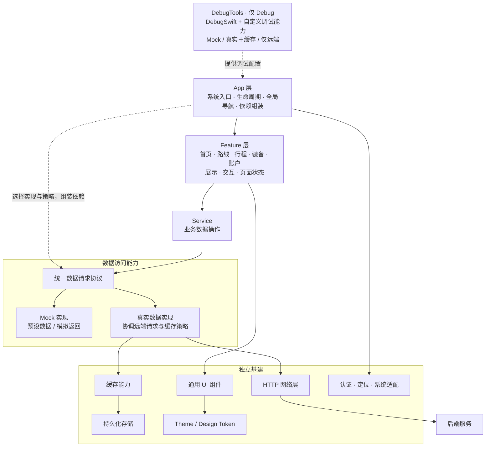

# Walk iOS 平台规范

本目录是 Walk 总规范在 iOS 上的**唯一平台规范入口**，只记录承载方式与实现差距，不记录产品事实。

## 上游权威

按以下顺序读取根协调仓 `walk/` 中的总规范（相对本文件解析）：

1. [总规范入口](../../docs/README.md) 与 [PRD](../../docs/prd.md)；
2. [平台无关行为 Spec](../../openspec/specs/)；
3. [Data](../../docs/data/)、[API](../../docs/api/)、[UI](../../docs/ui/index.md)。

本目录不是独立产品事实来源。总规范与本目录冲突时，总规范优先。

## 可以定义

- Data 到 Swift Model、API 到客户端请求/响应/错误模型的映射规则；
- Page、Component、Token 到 SwiftUI 的承载映射；
- iOS 导航承载、生命周期、系统权限与平台适配（Dynamic Type、VoiceOver、安全区）；
- fixture、测试入口、验证方法和当前实现差距。

## 不得定义

- 新的产品范围、业务行为、数据事实、枚举或 API 字段；
- 总 UI 中不存在的页面、组件、文案或可见状态；
- 与总规范不同的资格、状态流转或错误语义；
- 用默认值、Mock、兼容分支或现有代码反向补齐总规范。

总规范缺少 iOS 实现所需决策时，停止端内扩展，回到根仓 `docs/` 或 `openspec/` 的正确权威层提出变更。

## 登记规则

- 每个总 UI Page ID 和 Component ID 在本文件中有且仅有两种状态：**已映射**（指向当前生产承载源码）或**缺口**（登记为后续 Change 的输入）；
- 已映射只表示源码存在可确认的命名承载，不表示已通过内容符合性验收；近似实现不得冒充符合；
- 登记完整性由 [scripts/tests/test_platform_spec_registry.py](../scripts/tests/test_platform_spec_registry.py) 强制，不依赖手工维护的诚实；
- 缺口只能通过总规范批准的 Change 补齐，不得在本文件中把差距改写成总规范。

## App 架构基准

确认日期：2026-09-24。本节保存本轮讨论确定的 iOS **目标逻辑架构**，用于后续核对实现，不表示图中每项能力都已接入。当前代码的构成与差距见 [架构调研记录](../output/architecture-review-20260924.md)。

### 架构图



实线表示主要访问或组成关系，虚线表示配置与组装。协议连接 Mock / 真实实现，表示两种可替换的数据能力；协议本身不要求再增加一个运行时路由对象。

### 职责与依赖

| 层 / 能力 | 职责与边界 |
|---|---|
| App | 系统入口、生命周期、全局导航、最终配置解析和依赖组装；决定注入哪一种数据实现及策略。 |
| Feature | 按业务域组织展示、交互、页面状态与任务流程；通过 Service 请求业务数据。 |
| Service | 对页面提供类型化业务数据操作，经统一请求协议访问数据；不负责选择调试模式。后端业务事实仍由上游规范与后端拥有。 |
| 统一请求协议 | 为 Service 提供稳定入口，使业务调用不随 Mock / 真实实现切换而改变。 |
| Mock 实现 | 返回预设数据或模拟结果，与真实远端及其响应缓存分开。 |
| 真实数据实现 | 组合 HTTP 与缓存能力，根据配置和接口策略决定是否使用响应缓存。 |
| 缓存 / 持久化 | 缓存能力管理响应数据的复用，持久化承载数据读写；不属于 Mock，也不决定业务事实。 |
| Theme / 通用 UI | Theme 定义视觉 Token，通用 UI 组合可复用界面能力，供 Feature 消费。 |
| 认证 / 系统适配 | 承载认证会话以及系统权限、定位等平台能力，按需要提供给 App 或 Feature。 |
| DebugTools | 仅在 Debug 中接入 DebugSwift，并承载本 App 的自定义调试能力；向 App 提供配置，不进入业务请求链。 |

这些是逻辑职责边界，不要求每个方框都成为独立 Swift Package。Feature 与业务 Service 不依赖 DebugTools；调试配置由 App 转换为具体依赖和策略。

### Debug 数据运行模式

| 模式 | 数据能力 | 用途 |
|---|---|---|
| `mock` | Mock 实现返回预设或模拟数据 | 页面开发、场景复现 |
| `real` | 真实远端 + 本地响应缓存 | 真实数据链路，按策略使用缓存 |
| `remoteOnly` | 真实远端，绕过响应缓存读写 | 便于 E2E 验证真实请求链路 |

三种模式是调试配置；数据能力仍归为 Mock 与真实两类。`real` 和 `remoteOnly` 使用同一类真实请求能力，以缓存策略区分。这里的缓存开关针对请求响应缓存，不等于关闭登录态、调试设置等其他持久化。

缓存行为由独立策略决定，首版采用网络优先，并提供断网失败与断网尝试返回缓存两种策略；具体约束见下文「重构规范与约束」。DebugSwift 是选定的接入方案，不表示已经完成 SDK 接入或模式改造。

### 重构目标与工作拆分

阶段状态：第 1 步「目的与目标」已获用户认可；第 2 步「工作拆分」已记录；第 3 步「规范与约束」首版见下文；第 4 步已完成 W0 的[工程与测试基线修复](../output/refactor-w0-results-20260924.md)和[DebugSwift 最小接入与隔离验证](../output/debugswift-isolation-20260924.md)、W1 的[数据能力与缓存](../output/refactor-w1-results-20260925.md)，W2 的[App 配置与依赖装配](../output/refactor-w2-results-20260925.md)，W3 的[DebugTools 接入](../output/refactor-w3-results-20260925.md)，以及 W4 的[App / Feature / Service 整理](../output/refactor-w4-results-20260925.md)。W5–W6 尚未执行。SDK 网络观察仍关闭，开启前需按 R-DEBUG 补齐请求、缓存、认证与取消语义的证据。W1 建立的离线返回能力目前没有任何生产端点启用。

**重构目的**：把现有逻辑架构落实为职责明确、依赖清晰、容易修改和验证的代码结构，降低后续开发、问题定位和测试成本。衡量效果时关注修改位置是否明确、影响范围是否可控、结果是否可验证。

已认可的目标与完成标准：

| 目标 | 完成标准 |
|---|---|
| 各层职责明确 | App 承担入口、生命周期、全局导航与组装；Feature 承担展示、交互、页面状态与流程；Service 提供业务数据操作。 |
| 数据访问边界稳定 | Feature 通过 Service 获取业务数据；Service 使用统一请求协议，不自行判断运行模式。 |
| 真实数据能力统一 | Mock 与真实实现分开；真实实现组合 HTTP 与缓存，策略有统一归属，存储提供独立读写能力。 |
| 调试配置统一 | 支持三种数据模式；数据模式与服务器环境分开，由 App 根据最终配置组装依赖。 |
| 调试工具独立 | DebugSwift 与自定义能力由 DebugTools 承载，业务模块不依赖调试工具；Release 构建不引入调试能力。 |
| 基建职责明确 | Theme、通用 UI、网络、存储、认证具有清晰职责和使用入口，减少重复实现。 |
| 架构可以验证 | 能检查依赖方向，验证数据模式与缓存策略，并提供关键业务流程的回归证据。 |

工作分为保持已有业务行为的结构整理，以及三种数据模式、真实数据与缓存组合、DebugSwift 接入的能力补齐。产品功能、页面视觉、后端业务规则按现有上游约定承接；拆包粒度根据实际依赖与验证需要决定。

以下 W0–W6 是第 4 步的建议执行批次。每批包含自身验证，W6 汇总跨模块验收；第 3 步先确定共用规则，避免实施过程中分别补充隐含约定。

| 批次 | 工作范围与承载 | 交付物 / 验收点 | 依赖 |
|---|---|---|---|
| W0 现状与验证基线 | 盘点现有工作树、未完成草稿、工程依赖、测试与关键流程入口 | 记录实施前的构建/测试结果、已有失败、既有改动边界及回归清单；验证 DebugSwift 接入与 Debug/Release 隔离方案的可行性 | 第 3 步规范确定后开始执行 |
| W1 数据能力与缓存 | WalkData 的请求协议、HTTP、Mock、响应缓存、存储与认证接口边界 | 形成可组合的 Mock / 真实实现；按既定策略验证缓存行为、关闭响应缓存的真实请求，以及会话变化与在途请求的缓存行为；业务 Service 的调用面保持稳定 | W0；缓存、认证隔离及旧 local 路径迁移规则已确定 |
| W2 App 配置与依赖装配 | AppConfiguration、AppEnvironment 及旧 DebugEnvironment 的配置映射 | 数据模式与服务器环境分别解析；最终配置统一生成客户端、缓存与认证依赖；启动参数可确定性选择模式 | W1；配置优先级与生效方式已确定 |
| W3 DebugTools 接入 | DebugSwift 封装、App 调试入口、现有手写调试页与设置迁移、工程依赖 | 调试 UI 使用 W2 的同一配置入口；业务层不依赖 SDK；分别验证 Debug 可用与 Release 隔离；验证观察工具不改变 remoteOnly 的缓存语义 | W2；W0 接入方案验证完成 |
| W4 App / Feature / Service 整理 | RootView、RootNavigation、五个 Feature 及业务 Service 的职责连接 | 全局导航与依赖组装归 App，页面流程与状态归所属 Feature；按代表链路逐域整理并验证，不以文件长度作为拆分依据 | W2；可与 W3 并行，调试入口相关文件由 W3 统一修改 |
| W5 共用基建归属整理 | WalkDesignSystem、Feature 共用组件、Support 及认证/系统适配入口 | 根据实际复用和职责整理归属与可见接口，保持视觉及业务语义；只处理有明确收益的重复或越界，不为每个概念强制新增 Package | W4 梳理清楚使用关系；不重复改写 W1 已确定的数据基础设施 |
| W6 整体验收与记录 | 架构边界检查、模式集成验证、关键流程回归、文档与遗留入口 | 五域主链路、三模式、服务器环境切换与 Debug/Release 分别有适用证据；明确新旧入口迁移结果、已有问题与本轮新增问题；更新当前架构记录 | W1–W5 的批次验证完成 |

W1 与 W2 共享第 3 步确定的配置合同：WalkData 只接收所需策略与依赖，不读取 App 配置或引用 App 类型；App 负责将最终配置映射为这些参数。实施时可以按 Mock、真实＋缓存、仅远端逐条完成能力与接线验证。W3 通过回调或独立接口与 App 连接，不产生 DebugTools 对 App 实现的反向依赖。

第 2 步识别的规范议题：

- 各层允许的依赖方向、接口所有权、目录归属与拆包条件。
- 数据模式与服务器环境的定义、配置优先级、默认值、生效时机；旧参数、设置与 local 回放能力如何迁移。
- 缓存资格、读取/刷新/过期/失效规则，错误处理与回退范围；服务器环境、用户和 Mock/真实认证会话的隔离规则；退出登录、认证失效及环境切换时对旧请求、响应和页面状态的处理。
- DebugSwift 的能力边界、构建隔离与配置接入方式；remoteOnly 的验证范围覆盖应用响应缓存和 HTTP 客户端缓存。
- 分批修改与验证约束：保护已有改动、区分存量失败、为新增行为建立针对性测试；测试验证可观察行为和依赖边界，减少对文件名与源码字符串的绑定。

这些议题的首版规则统一记录在下节。SDK 版本及工程隔离方案的可行性由 W0 验证，接口级离线资格及有效期需要逐项登记，不能从现有 `.store` 标记推导。

### 重构规范与约束

本节是第 3 步形成的首版实施约束，供 W0–W6 使用，不代表当前实现已符合。用户明确要求将「断网失败 / 断网返回缓存」建模为策略，因此缓存回退不固定在真实客户端内部。其余工程规则以保持已有业务行为和可验证性为原则制定。

#### 1. 范围与模块边界

**R-SCOPE**：结构整理保持现有业务、导航和视觉合同；三模式与 DebugTools 属于本轮能力补齐。涉及离线页面语义、业务资格、错误语义或 API 合同的新决定，归相应上游规范，不能通过移动代码、Mock 或缓存策略暗中改变。

**R-DEP**：依赖遵守下表。逻辑独立不强制逐项拆包；只有编译隔离、独立验证或复用确有需要时新增物理模块。

| 所有者 | 承担与允许依赖 | 边界 |
|---|---|---|
| App | 最终配置、实例生命周期、依赖装配、全局导航、系统事件连接 | 页面内部流程归 Feature；App 是业务客户端、存储与认证实例的生产装配入口。 |
| Feature | 展示、交互、页面状态、任务编排；消费业务 Service 合同、设计系统、必要系统适配及导航动作合同 | 不创建具体 APIClient、HTTP Session 或响应存储；不读取运行模式；不引用其他 Feature 的页面/VM 或 App 根实现。 |
| Service | 类型化业务数据操作与必要结果转换，消费 APIClient 等数据合同 | 不决定运行模式、不呈现 UI、不自行创建全局客户端；不得补造后端业务事实。 |
| WalkData | 请求/响应/错误合同、Service、Mock、真实客户端、缓存、存储与认证能力 | 不依赖 App、Features、WalkDesignSystem、DebugTools；不重新读取 App 配置源来选择模式。 |
| WalkDesignSystem | Theme、通用 UI 和通用展示值 | 不依赖业务数据模型、Service 或调试工具；绑定业务对象的组件留在所属 Feature。 |
| DebugTools | 调试展示、诊断、配置动作意图 | 通过 App 注入的状态与回调连接，不反向引用 App 实现、不创建业务依赖、不持有第二份有效配置。 |

导航意图可放在明确的共享合同位置，跨域流程由 App 或共享业务 Service 协调。Feature 内部具体页面和 VM 不作为跨域复用接口。Preview、组件体验与生产页面消费同一组件实现。

#### 2. 配置、默认值与切换

**R-CONFIG**：以下三个维度独立，统一由 App 解析、校验并冻结为一次启动的有效配置：

- 数据模式：`mock / real / remoteOnly`。
- 服务器身份：稳定环境标识与规范化 baseURL；标识相同但地址不同也视为不同服务。
- 执行上下文：正常运行、测试、Preview、Baseline，以及 Debug / Release 构建类型。不能仅凭服务器名为 `test` 判断当前一定处于自动化测试。

模式只选择数据能力；切换服务器不隐式改变模式。`mock` 不请求业务服务器。真实模式必须有有效服务地址；不得因地址配置错误自动改用 Mock 或其他服务器。Debug 构建默认沿用 Mock，Release 固定使用构建配置的生产服务与 `real`，采用默认断网失败策略；显式开发配置可覆盖 Debug 默认值。

Debug 配置的优先级统一为：**显式启动参数 > 进程环境变量 > 已保存的 Debug 设置 > 构建配置 > 代码默认值**。来源以可注入输入传入解析器；测试、Preview、Baseline 忽略个人 Debug 设置并显式注入场景配置。未知、空白或同一来源内相互冲突的显式配置报错，不静默降级。Release 不读取 Debug 偏好，也不接受开发模式切换入口。

**R-SWITCH**：首版保留重启生效。DebugTools 展示当前有效值与待生效值；保存配置只影响下一次启动，不热替换某个 Service、缓存或认证实例，也不立即删除当前会话。启动时统一创建依赖，避免一个 App 同时使用新旧服务。待生效提示根据两份配置是否不同计算。

#### 3. 数据模式与缓存策略

**R-MODE**：统一业务访问入口保持类型化，具体数据能力分为 Mock 与真实两类。`real / remoteOnly` 使用同一类真实实现，通过策略装配区分。

| 模式 | 真实业务网络 | 响应缓存 | 断网行为 |
|---|---|---|---|
| `mock` | 不调用 | 不访问真实响应缓存 | 由模拟场景定义结果，不回退真实请求 |
| `real` | 网络优先 | 根据端点资格和策略读写 | 按 `OfflinePolicy` 执行 |
| `remoteOnly` | 发起真实请求 | 绕过应用响应缓存及 HTTP 客户端缓存，不读取验证器、不保存响应 | 返回网络错误；任何缓存策略都不能覆盖该模式 |

`remoteOnly` 针对业务请求响应链，不关闭 Keychain、调试配置等其他持久化，也不宣称绕过后端/CDN内部缓存。E2E 需要通过受控服务或请求日志证明真实请求到达；仅有页面显示成功不算证据。

**R-CACHE-POLICY**：首版读取顺序为网络优先，失败处理独立建模：

| 策略 | 明确断网 / 连接中断后的行为 |
|---|---|
| `fail` | 返回本次连接错误，不以缓存替代结果；这是未配置时的默认值。 |
| `useCache` | 对允许离线读取的只读端点，尝试返回同服务、同身份、未失效且符合有效期的缓存；没有合格缓存时仍返回原始连接错误。 |

策略由数据层执行，App 注入默认策略，端点声明允许范围与所需规则；DebugTools 可选择已允许的策略。优先级是 **模式硬约束 → 端点资格/上游合同 → 所选策略 → 缓存有效性**。全局选择 `useCache` 不会让所有接口自动具备离线返回资格。

断网原因来自结构化传输错误，不解析错误文案，也不单靠网络可达性预判。首版仅明确的未连接网络、连接中断触发 `useCache`；超时、401/403、其他 HTTP 错误、业务错误、解码错误和取消保持原语义，不自动回退。修改命令始终等待远端结果，不缓存回放成功，也不在离线时排队提交。

**R-CACHE-VALIDITY**：允许保存与允许离线读取分别声明，现有 `.store` 只能证明保存资格。离线资格至少登记上游依据、有效期、失效事件及调用方如何处理缓存来源；缺少任何一项时默认不允许离线返回。不自行统一指定“所有数据缓存若干分钟”，不借业务日期、revision 或天气可信状态推导有效期；首版不返回过期缓存。

**R-RESULT**：启用 `useCache` 的调用链必须携带结果来源与保存时间，必要时携带本次回退原因；Service 与页面能够区分本次远端结果和本地缓存结果。这是客户端结果上下文，不增加后端 DTO 字段；不通过共享的“最后一次请求来源”记录并发请求信息。W1 决定具体类型承载，保留兼容入口时不得丢弃此语义。

缓存来源标记不自动授权新的离线页面行为。[个人行程读取失败](../../openspec/specs/trip-lifecycle/spec.md)、[路线事实完整性](../../openspec/specs/public-route/spec.md) 与 [API 错误合同](../../docs/api/api-common-contract.md) 继续有效。本轮可以实现并验证 `useCache` 策略能力；具体生产端点是否启用，按上述资格登记，不把整个 App 一次性切成离线成功。

#### 4. 缓存、存储与一致性

**R-STORAGE**：首版仅缓存明确允许的只读 GET 成功响应。登录、验证码、令牌响应和修改命令不缓存；个人资源读取按端点资格和身份隔离。HTTP 缓存指令仍须遵守：`no-store` 不保存；`no-cache` 的复用需要成功验证，不能当作离线返回许可。条件验证及变体匹配遵循 [RFC 9111](https://www.rfc-editor.org/rfc/rfc9111.html#section-4.3)，不假设当前后端已经支持验证器或 304。HTTP 客户端不得另外绕过所选策略返回缓存。

缓存记录包含业务响应及必要的请求匹配、来源时间和缓存控制元数据；命名空间至少隔离服务身份、模型版本、会话/用户、请求及影响响应的表示差异。存储只负责读写，不负责端点资格、回退选择或业务规则。旧的纯 JSON 快照缺少策略所需元数据时，不能直接升级为可离线返回的缓存。

缓存缺失、损坏、身份不匹配、已失效或过期都视为缓存不可用。网络成功后的缓存写入失败不抹掉已取得的有效远端结果；网络失败且缓存不可用时保留原始失败，不转换为空集合、无焦点或不存在。

**R-INVALIDATION**：首版采用保守失效范围，成功修改或修改结果不确定后使当前服务与会话的响应缓存失效；涉及公开资源的变更也覆盖对应公开缓存。失效过程必须阻止旧在途读取重新写回缓存或覆盖新的页面结果。不能将修改响应直接写入形状不同的 GET 缓存。

退出、认证失效、切换身份会推进会话有效性并清理或隔离个人响应；旧响应不能恢复认证、回填新身份缓存或继续向新会话发布个人数据。[退出登录语义](../../openspec/specs/account-access/spec.md) 保持不变。`remoteOnly` 请求不访问响应缓存；再次进入 `real` 时需使此前缓存失效，避免忽略 `remoteOnly` 期间的修改，该失效属于启动生命周期管理。

#### 5. 认证与配置迁移

**R-AUTH**：客户端、Service 与页面使用 App 注入的同一认证实例；认证管理器不重新读取启动参数、Info.plist 或 Debug 偏好选择模式。认证命名空间以最终服务身份为基础，再区分 Mock 与真实：Mock 独立；同一服务下 `real / remoteOnly` 共用真实会话；不同环境标识或不同 baseURL 隔离。服务地址的身份包括协议、主机、有效端口和 API 基路径，不能仅比较显示名称。

**R-MIGRATION**：内部统一新模型，迁移覆盖脚本、scheme、UI 测试与基线入口。用户已确认现有登录态、Debug 设置与启动键均为临时状态，因此 W2 不保留兼容别名，也不迁移旧数据。旧键显式报错，防止被静默忽略。

| 旧入口 | 首版迁移规则 |
|---|---|
| `remote / mock` | 分别解析为 `real / mock`；`remote` 不隐式授予离线读取资格。 |
| `local` App 模式 | 没有等价新模式，显式报不支持；缓存回放需要在测试中直接注入，不能映射为真实网络或 remoteOnly。 |
| `-DataSourceMode` / `WALK_DATA_SOURCE_MODE` / `WalkDataSourceMode` | 已退役，传入即报 `retiredKey`。规范键为 `-WalkDataMode` / `WALK_DATA_MODE` / `WalkDataMode`，取值 `mock / real / remoteOnly`（大小写不敏感）；旧值 `remote` 不再被接受。仓内 scheme、`project.yml` 与测试启动参数已全部改用新键。 |
| 服务器参数与构建默认值 | 保留现有 `-APIBaseURL`、`-WalkEnvironment` 及对应环境/Info 键的承载，拆开服务器身份与测试执行上下文。不得凭旧 `testServer` 名称推断已有独立测试部署。 |
| 旧 Debug 环境预设 | 不迁移。`walk.debug.environment` 不再被读取；Debug 设置保存为带版本的单一记录 `walk.debug.settings`，数据模式与服务器分别可选，未设置的维度回落到下一级来源；无法读取或版本更高的记录被忽略，不猜测。 |
| 旧认证槽位 | 不迁移。旧 `auth_token` / `auth_token_mock` 没有服务来源记录，且被多个环境共用，按本规则不能复制到任何当前地址。认证命名空间改为由 Mock/真实与服务身份组成的新键，升级后需重新登录一次。 |

#### 6. DebugTools 与工程隔离

**R-DEBUG**：DebugSwift 放在独立调试适配层，App 注入只读配置快照与设置、清缓存等动作回调，数据模块执行实际操作。调试能力不成为业务链路的运行前提，也不在 Feature 中留下 SDK 调用。

Release 的编译/链接输入与最终产物不得包含 DebugSwift 及其资源。仅在调用处使用 `#if DEBUG` 不构成完成证据；W0 验证可行的 target/依赖组织，W3 在实际接入后提供产物检查。SDK 网络观察不得改变请求、缓存、认证和取消语义；无法保证时关闭相关拦截并使用受控诊断入口。诊断信息不输出 Token 等凭据。

工程结构以 `project.yml` 为源，新增目录/target 后通过 XcodeGen 生成；固定并记录验证过的依赖版本。各模块依赖只声明实际需要的内容，不为文件搬迁引入新的框架或架构模式。

**W0 已验证的 W3 工程方案**：共用 XcodeGen 模板，分别生成开发与生产依赖图；仅开发图引入 DebugTools → DebugSwift，生产图不声明二者。候选版本固定为已经实测的 DebugSwift 1.19.0。正式构建入口在启动工具前校验模式、configuration 和 action，开发入口拒绝 Release 与 archive；发布入口只生成生产图，并执行依赖、编译、link map、符号/动态依赖和资源检查。

单配置工程不能阻止原始 `xcodebuild -configuration Release` 强行覆盖，因此不能把「开发工程没有 Release 配置」视为隔离保证；受支持入口及发布检查必须一并落地。最小宿主已验证面板和自定义信息展示，默认禁用网络等自动监控钩子；正式 App 接入、配置回调及监控语义仍由 W3 验证。完整证据与复现入口见 [W0 SDK 验证记录](../output/debugswift-isolation-20260924.md)。

#### 7. 实施与验收

**R-VERIFY**：W0 记录工作树、已有草稿与失败；每批修改都包含针对其行为的验证。新增行为先建立最小失败测试；纯文件归属调整复用已有检查，不为实现细节编造测试。不能把已存在失败算作本轮引入，也不能通过删除断言掩盖新增失败。

| 验收面 | 最小证据 |
|---|---|
| 架构依赖 | 包/target 依赖图与生产装配路径；边界检查聚焦禁止依赖，不绑定局部函数名或完整 SwiftUI 源码字符串。 |
| 配置 | 来源优先级、非法值、新旧键、执行上下文隔离、待生效配置不影响当前实例；同名不同地址按不同服务隔离。 |
| 数据模式 | Mock 真实业务 HTTP 为零；real 按资格和策略读写；remoteOnly 在预置应用及 HTTP 缓存情况下仍发真实请求且响应缓存读写为零。 |
| 断网策略 | 同一端点分别验证 fail 返回连接错误、useCache 返回合格缓存及来源；缺失/过期/损坏/身份不匹配时保留错误；不合格端点及非断网错误不回退。 |
| 生命周期 | Mock 与真实认证隔离、real/remoteOnly 共用会话、不同服务隔离；修改/退出后的旧响应不写回、不覆盖新结果。 |
| Debug / Release | Debug 配置动作实际连接 App；SDK 接入后的 Release 编译/链接记录与产物隔离；网络诊断开启时重复验证缓存规则。 |
| 业务与 UI | 受影响的导航、登录、五域加载与操作回归；公共组件在独立体验与消费页面保持一致。 |
| E2E 与证据 | 明确 scheme、destination、测试身份与存储；remoteOnly 真实到达受控服务的证据；最终报告区分存量失败、新增失败与未验证范围。 |

单元测试使用注入的网络、存储、时钟与身份，不依赖真实账号或个人 Debug 设置；E2E 显式选择服务器与模式。W6 汇总各批的新鲜证据并更新架构记录。已认可的目标是上述规则的验收依据，本节本身不是实现完成证明。

## Page 映射

| 总 UI Page ID | SwiftUI 承载 | 源码 |
|---|---|---|
| `PAGE-LOGIN` | `LoginView` | `Walk/Features/Profile/LoginView.swift` |
| `PAGE-HOME` | `HomeView` | `Walk/Features/Home/HomeView.swift` |
| `PAGE-ROUTES` | `RouteDiscoveryView` | `Walk/Features/Routes/RouteDiscoveryView.swift` |
| `PAGE-ROUTE-LIST` | `RouteCollectionView` | `Walk/Features/Routes/RouteDiscoveryView.swift` |
| `PAGE-SEARCH` | `RouteSearchView` | `Walk/Features/Routes/RouteDiscoveryView.swift` |
| `PAGE-ROUTE-DETAIL` | `RouteDetailView` | `Walk/Features/Routes/RouteDetailView.swift` |
| `PAGE-TRIP-CREATE` | `CreateTripView` | `Walk/Features/Trips/CreateTripView.swift` |
| `PAGE-TRIP-DETAIL` | `TripDetailView` | `Walk/Features/Trips/TripDetailView.swift` |
| `PAGE-TRIP-BROWSE` | `TripBrowseView` | `Walk/Features/Trips/TripBrowseView.swift` |
| `PAGE-TRIP-WEATHER` | `TripWeatherView` | `Walk/Features/Trips/TripDayWeatherViews.swift` |
| `PAGE-TRIP-EQUIPMENT` | `TripEquipmentView` | `Walk/Features/Trips/TripEquipment.swift` |
| `PAGE-TRIPS` | `TripListView` | `Walk/Features/Trips/TripListView.swift` |
| `PAGE-ME` | `ProfileView` | `Walk/Features/Profile/ProfileView.swift` |
| `PAGE-ACCOUNT-MENU` | `AccountMenuView` | `Walk/Features/Profile/AccountMenuView.swift` |
| `PAGE-MY-EQUIPMENT` | `EquipmentListView` | `Walk/Features/Equipment/EquipmentListView.swift` |
| `PAGE-EQUIPMENT-EDIT` | `EquipmentEditView` | `Walk/Features/Equipment/AddEquipmentView.swift` |

`PAGE-ROUTES` 沉浸式分页承接根仓 Change `route-discovery-immersive-paging`：`RouteDiscoveryView` 以 SwiftUI 纵向 `ScrollView` 的原生 paging 承载整屏 RouteScene，页头作为固定覆盖层；分页内容延伸到系统 tab bar 之后。系统区域读取集中在 WalkDesignSystem 的 `immersiveSystemAreaContext`，RouteScene 只通过 `immersiveBottomContentPadding` 声明底部内容避让，不读取或接收物理 inset。结构验证入口为 `RouteDiscoveryPagerStructureTests` 与 `DesignSystemTests.testSafeAreaInsetHandlingLivesInSharedPageContainers`。

导航承载与 Page ID 转换位于 `Walk/App/RootNavigation.swift` 和 `Walk/App/RootView.swift`。它们只负责 iOS 导航，不拥有页面范围或跨页面业务结果。

二级导航行为统一（任务栈推入、唯一返回入口及其可见性、覆盖层边界）由根仓 Change `unify-navigation-behavior` 定义；iOS 承载决策：全部二级页复用根仓 `AppDestination` 路径推入，返回入口统一由 `dismiss` 语义承载，`routeListShowsBackEntry` 等返回可见性状态归入路径来源语义，不在各 Feature 页内自行决定返回行为。例外：`PAGE-LOGIN` 为 Modal 任务，由 `AppShellState.isLoginPresented` 驱动的 `fullScreenCover` 全屏承载，不进入任务栈。

二级页统一悬浮导航承载（承接根仓 Change `unify-secondary-page-navigation-and-titles`）：`UtilityNavigationHeader` 以悬浮形态承载（无固定底色与下边界线、`IconButton.overlay` 圆形返回、可选标题），全部任务栈二级页与 `PAGE-TRIP-DETAIL` 封面返回使用同一形态与顶部左上角统一位置；`PAGE-ROUTE-LIST` 返回可见性由到达方式决定（复用 `routeListShowsBackEntry`）；任务栈二级页不再输出宣传性 kicker（`PageTitleBlock` 不传 kicker），`PAGE-TRIPS` 正文不再重复页面标题块，页面标题只呈现一次。

### PAGE-ACCOUNT-MENU 承载登记（承接根仓 Change `revamp-account-settings-modal`）

- 模态承载：`AccountMenuView` 由 `AppShellState.isAccountMenuPresented` 驱动，在 `RootView` 以 overlay 呈现 `ModalBottomSheet`，不进入任何任务栈；不启用 Sheet 右上角 CloseAction。
- 关闭边界：`ModalBottomSheet` 支持向下拖拽跟手、超过关闭距离/速度关闭、未达阈值回位，且仅内容处于滚动顶部时接管拖动手势；遮罩点击与拖拽关闭共用同一 `onDismiss`。
- 设置项承接：设置主页 `AccountMenuView` 只承载入口；选择任一设置项（个人资料/通知/隐私/帮助与反馈/关于 Walk）由 `RootView.onNavigate` 先关闭菜单再推入我的页任务栈（`AppDestination.profileDetails/.notificationSettings/.privacySettings/.helpAndFeedback/.about` 均映射 `PAGE-ME`），返回经 `dismiss` 回到我的页；不新增 Page ID，二级内容合同由根仓 `PAGE-ACCOUNT-MENU/spec.md` 定义。
- 二级页壳：`SettingsDetailPage`（悬浮 `IconButton` 返回 + 内容区标题）与 `SurfaceElevated` / `EntrySettingsRow`（左右行 + `AppColors.surfaceDivider` 横线）位于 `Walk/Features/Profile/ProfileEntryPages.swift`；五个设置二级页共享同一生产内容实现。
- 头像更新：`ProfileViewModel.updateAvatar(data:contentType:)` 先上传头像媒体取得 `mediaReference` 再写入 Profile，成功刷新共享 `account.profile`；照片来源为系统相册（`photosPicker(isPresented:)`）。

## Component 映射

### 通用组件

| 总 UI Component ID | SwiftUI 承载 | 源码 |
|---|---|---|
| `avatar-button` | `AvatarButton` | `Packages/WalkDesignSystem/Sources/WalkDesignSystem/Components/SharedPrimitives.swift` |
| `card` | `WalkCard` | `Packages/WalkDesignSystem/Sources/WalkDesignSystem/Components/SharedPrimitives.swift` |
| `confirmation-dialog` | `ConfirmationDialog` | `Packages/WalkDesignSystem/Sources/WalkDesignSystem/Components/ConfirmationDialog.swift` |
| `content-section` | `ContentSection` | `Packages/WalkDesignSystem/Sources/WalkDesignSystem/Components/ContentSection.swift` |
| `danger-action` | `DangerAction` | `Packages/WalkDesignSystem/Sources/WalkDesignSystem/Components/SharedPrimitives.swift` |
| `date-input` | `DateInput` | `Packages/WalkDesignSystem/Sources/WalkDesignSystem/Components/DateInput.swift` |
| `empty-state` | `EmptyStateView` | `Packages/WalkDesignSystem/Sources/WalkDesignSystem/Components/EmptyStateView.swift` |
| `error-view` | `ErrorView` | `Packages/WalkDesignSystem/Sources/WalkDesignSystem/Components/ErrorView.swift` |
| `fixed-action-area` | `FixedActionArea` | `Packages/WalkDesignSystem/Sources/WalkDesignSystem/Components/SharedPrimitives.swift` |
| `form-field` | `FormField` | `Packages/WalkDesignSystem/Sources/WalkDesignSystem/Components/FormField.swift` |
| `icon-button` | `IconButton` | `Packages/WalkDesignSystem/Sources/WalkDesignSystem/Components/SharedPrimitives.swift` |
| `info-tag` | `InfoTag` | `Packages/WalkDesignSystem/Sources/WalkDesignSystem/Components/SharedPrimitives.swift` |
| `list-row` | `ListRow` | `Packages/WalkDesignSystem/Sources/WalkDesignSystem/Components/SharedPrimitives.swift` |
| `loading-state` | `LoadingView` | `Packages/WalkDesignSystem/Sources/WalkDesignSystem/Components/LoadingView.swift` |
| `metric-group` | `MetricGroup` | `Packages/WalkDesignSystem/Sources/WalkDesignSystem/Components/MetricGroup.swift` |
| `metric-item` | `MetricItem` | `Packages/WalkDesignSystem/Sources/WalkDesignSystem/Components/MetricItem.swift` |
| `mixed-page-shell` | `MixedPageShell` | `Packages/WalkDesignSystem/Sources/WalkDesignSystem/Components/MixedPageShell.swift` |
| `modal-bottom-sheet` | `ModalBottomSheet` | `Packages/WalkDesignSystem/Sources/WalkDesignSystem/Components/ModalBottomSheet.swift` |
| `notice` | `NoticeView` | `Packages/WalkDesignSystem/Sources/WalkDesignSystem/Components/SharedPrimitives.swift` |
| `page-title-block` | `PageTitleBlock` | `Packages/WalkDesignSystem/Sources/WalkDesignSystem/Components/SharedPrimitives.swift` |
| `panel` | `WalkPanel` | `Packages/WalkDesignSystem/Sources/WalkDesignSystem/Components/SharedPrimitives.swift` |
| `primary-action` | `PrimaryAction` | `Packages/WalkDesignSystem/Sources/WalkDesignSystem/Components/SharedPrimitives.swift` |
| `quantity-stepper` | `QuantityStepper` | `Packages/WalkDesignSystem/Sources/WalkDesignSystem/Components/SharedPrimitives.swift` |
| `search-field` | `SearchField` | `Packages/WalkDesignSystem/Sources/WalkDesignSystem/Components/SearchField.swift` |
| `secondary-action` | `SecondaryAction` | `Packages/WalkDesignSystem/Sources/WalkDesignSystem/Components/SharedPrimitives.swift` |
| `section-header` | `SectionHeader` | `Packages/WalkDesignSystem/Sources/WalkDesignSystem/Components/SharedPrimitives.swift` |
| `segmented-control` | `SegmentedControl` | `Packages/WalkDesignSystem/Sources/WalkDesignSystem/Components/SharedPrimitives.swift` |
| `select-input` | `SelectInput` | `Packages/WalkDesignSystem/Sources/WalkDesignSystem/Components/SelectInput.swift` |
| `selectable-option-card` | `SelectableOptionCard` | `Packages/WalkDesignSystem/Sources/WalkDesignSystem/Components/SharedPrimitives.swift` |
| `settings-list-row` | `SettingsListRow` | `Packages/WalkDesignSystem/Sources/WalkDesignSystem/Components/SettingsListRow.swift` |
| `sheet-handle` | `SheetHandle` | `Packages/WalkDesignSystem/Sources/WalkDesignSystem/Components/SharedPrimitives.swift` |
| `source-note` | `SourceNote` | `Packages/WalkDesignSystem/Sources/WalkDesignSystem/Components/SharedPrimitives.swift` |
| `text-input` | `TextInput` | `Packages/WalkDesignSystem/Sources/WalkDesignSystem/Components/TextInput.swift` |
| `timeline` | `Timeline` | `Packages/WalkDesignSystem/Sources/WalkDesignSystem/Components/SharedPrimitives.swift` |
| `unavailable-state` | `UnavailableStateView` | `Packages/WalkDesignSystem/Sources/WalkDesignSystem/Components/SharedPrimitives.swift` |
| `utility-navigation-header` | `UtilityNavigationHeader` | `Packages/WalkDesignSystem/Sources/WalkDesignSystem/Components/UtilityNavigationHeader.swift` |
| `utility-page` | `UtilityPage` | `Packages/WalkDesignSystem/Sources/WalkDesignSystem/Components/SharedPrimitives.swift` |

### 业务组件

| 总 UI Component ID | 层 | SwiftUI 承载 | 源码 |
|---|---|---|---|
| `auth-panel` | L2b 业务独立 | `AuthPanel` | `Walk/Features/Profile/Components/AuthPanel.swift` |
| `checklist-item-row` | L2b 业务独立 | `ChecklistItemRow` | `Walk/Features/Equipment/Components/ChecklistItemRow.swift` |
| `checklist-panel` | L2c 业务组合 | `ChecklistPanel` | `Walk/Features/Equipment/Components/ChecklistPanel.swift` |
| `daily-weather-card` | L2b 业务独立 | `DailyWeatherCard` | `Walk/Features/Trips/Components/DailyWeatherCard.swift` |
| `daily-weather-summary-row` | L2b 业务独立 | `DailyWeatherSummaryRow` | `Walk/Features/Trips/Components/DailyWeatherSummaryRow.swift` |
| `elevation-profile` | L2b 业务独立 | `ElevationProfile` | `Walk/Features/Routes/Components/ElevationProfile.swift` |
| `equipment-deletion-impact` | L2b 业务独立 | `EquipmentDeletionImpact` | `Walk/Features/Equipment/Components/EquipmentDeletionImpact.swift` |
| `equipment-list-row` | L2b 业务独立 | `EquipmentListRow` | `Walk/Features/Equipment/Components/EquipmentListRow.swift` |
| `focus-trip-summary` | L2b 业务独立 | `FocusTripSummary` | `Walk/Features/Home/Components/FocusTripSummary.swift` |
| `gear-ring` | L2a 业务原子 | `GearRing` | `Walk/Features/Trips/Components/GearRing.swift` |
| `generation-equipment-selection` | L2c 业务组合 | `GenerationEquipmentSelection` | `Walk/Features/Shared/Components/GenerationEquipmentSelection.swift` |
| `generation-route-summary-card` | L2b 业务独立 | `GenerationRouteSummaryCard` | `Walk/Features/Shared/Components/GenerationRouteSummaryCard.swift` |
| `generation-waiting-view` | L2b 业务独立 | `GenerationWaitingView` | `Walk/Features/Shared/Components/GenerationWaitingView.swift` |
| `inline-equipment-editor` | L2b 业务独立 | `InlineEquipmentEditor` | `Walk/Features/Shared/Components/InlineEquipmentEditor.swift` |
| `inline-list-name-editor` | L2b 业务独立 | `InlineListNameEditor` | `Walk/Features/Equipment/Components/InlineListNameEditor.swift` |
| `personal-equipment-form` | L2b 业务独立 | `PersonalEquipmentForm` | `Walk/Features/Equipment/Components/PersonalEquipmentForm.swift` |
| `personal-equipment-summary-card` | L2b 业务独立 | `PersonalEquipmentSummaryCard` | `Walk/Features/Profile/Components/PersonalEquipmentSummaryCard.swift` |
| `profile-identity-header` | L2b 业务独立 | `ProfileIdentityHeader` | `Walk/Features/Profile/Components/ProfileIdentityHeader.swift` |
| `route-fact-section` | L2b 业务独立 | `RouteFactSection` | `Walk/Features/Routes/Components/RouteFactSection.swift` |
| `route-image-gallery` | L2b 业务独立 | `RouteImageGallery` | `Walk/Features/Routes/Components/RouteImageGallery.swift` |
| `route-introduction` | L2b 业务独立 | `RouteIntroduction` | `Walk/Features/Routes/Components/RouteIntroduction.swift` |
| `route-list-row` | L2b 业务独立 | `RouteListRow` | `Packages/WalkDesignSystem/Sources/WalkDesignSystem/Components/SharedPrimitives.swift` |
| `route-map` | L2b 业务独立 | `RouteMap` | `Walk/Features/Routes/Components/RouteMap.swift` |
| `route-map-dock` | L2b 业务独立 | `RouteMapDock` | `Walk/Features/Routes/Components/RouteMapDock.swift` |
| `route-point-detail` | L2b 业务独立 | `RoutePointDetail` | `Walk/Features/Routes/Components/RoutePointDetail.swift` |
| `route-point-section` | L2b 业务独立 | `RoutePointSection` | `Walk/Features/Routes/Components/RoutePointSection.swift` |
| `route-reference-day-list` | L2b 业务独立 | `RouteReferenceDayList` | `Walk/Features/Routes/Components/RouteReferenceDayList.swift` |
| `route-scene` | L2b 业务独立 | `RouteScene` | `Walk/Features/Routes/Components/RouteScene.swift` |
| `route-segment-list` | L2b 业务独立 | `RouteSegmentList` | `Walk/Features/Routes/Components/RouteSegmentList.swift` |
| `route-span-card` | L2b 业务独立 | `RouteSpanCard` | `Walk/Features/Routes/Components/RouteSpanCard.swift` |
| `route-summary` | L2b 业务独立 | `RouteSummary` | `Walk/Features/Routes/Components/RouteSummary.swift` |
| `search-route-result-row` | L2b 业务独立 | `SearchRouteResultRow` | `Walk/Features/Routes/Components/SearchRouteResultRow.swift` |
| `transport-option-selection` | L2b 业务独立 | `TransportOptionSelection` | `Walk/Features/Shared/Components/TransportOptionSelection.swift` |
| `trek-day-badge` | L2a 业务原子 | `TrekDayBadge` | `Walk/Features/Trips/Components/TrekDayBadge.swift` |
| `trip-calendar-card` | L2b 业务独立 | `TripCalendarCard` | `Walk/Features/Shared/Components/TripCalendarCard.swift` |
| `trip-cover-header` | L2b 业务独立 | `TripCoverHeader` | `Walk/Features/Trips/Components/TripCoverHeader.swift` |
| `trip-day-arrangement` | L2c 业务组合 | `TripDayArrangement` | `Walk/Features/Trips/Components/TripDayArrangement.swift` |
| `trip-day-overview-entry` | L2b 业务独立 | `TripDayOverviewEntry` | `Walk/Features/Trips/Components/TripDayOverviewEntry.swift` |
| `trip-equipment-gear-rings` | L2c 业务组合 | `TripEquipmentGearRings` | `Walk/Features/Trips/Components/TripEquipmentGearRings.swift` |
| `trip-equipment-item-row` | L2b 业务独立 | `TripEquipmentItemRow` | `Walk/Features/Trips/Components/TripEquipmentItemRow.swift` |
| `trip-equipment-overview` | L2b 业务独立 | `TripEquipmentOverview` | `Walk/Features/Trips/Components/TripEquipmentOverview.swift` |
| `trip-equipment-summary-card` | L2c 业务组合 | `TripEquipmentSummaryCard` | `Walk/Features/Trips/Components/TripEquipmentSummaryCard.swift` |
| `trip-list-row` | L2b 业务独立 | `TripListRow` | `Walk/Features/Trips/Components/TripListRow.swift` |
| `trip-route-metrics-summary` | L2b 业务独立 | `TripRouteMetricsSummary` | `Walk/Features/Trips/Components/TripRouteMetricsSummary.swift` |
| `trip-route-summary-card` | L2b 业务独立 | `TripRouteSummaryCard` | `Walk/Features/Trips/Components/TripRouteSummaryCard.swift` |
| `trip-status-badge` | L2a 业务原子 | `TripStatusBadge` | `Walk/Features/Trips/TripStatusBadge.swift` |
| `trip-weather-summary-card` | L2c 业务组合 | `TripWeatherSummaryCard` | `Walk/Features/Trips/Components/TripWeatherSummaryCard.swift` |
| `trip-weather-trend-chart` | L2c 业务组合 | `TripWeatherTrendChart` | `Walk/Features/Trips/Components/TripWeatherTrendChart.swift` |
| `weather-overview` | L2b 业务独立 | `WeatherOverview` | `Packages/WalkData/Sources/WalkData/API/Trips/PersonalTripModels.swift` |
| `weather-summary` | L2a 业务原子 | `WeatherSummary` | `Walk/Features/Home/Components/WeatherSummary.swift` |

「层」对应根仓 `docs/ui/taxonomy.md` 的业务组件分层（L2a 业务原子 / L2b 业务独立 / L2c 业务组合），由总 UI 目录 `components/business/{atoms,components,composites}/` 的共置目录决定，本文件不另行归层。

## Token 映射

Token 承载家族位于 `Packages/WalkDesignSystem/Sources/WalkDesignSystem/Theme/`（`Color+App.swift`、`Font+App.swift`、`Spacing.swift`、`Radius.swift`、`Shadow.swift`）。

**已知缺口**：Token 尚未建立与总 UI Token 一一对应的逐项分区登记（历史版本的逐项表随旧规范结构一并移除）。逐项分区与配套测试列入后续平台符合性 Change，在此之前不得从近似颜色、字号或阴影推断符合。

## 变更流程

- 总规范变更：根仓 OpenSpec Change 批准后，本目录在 iOS 仓提交中引用该 Change ID 承接映射更新；
- 平台独有决策：直接修改本目录，只改「怎么承载」，不改「是什么」；
- 事实冲突：总规范优先；无法映射：停止端内扩展并回根仓立 Change。

## 验证

```bash
python3 scripts/tests/test_platform_spec_registry.py
```
